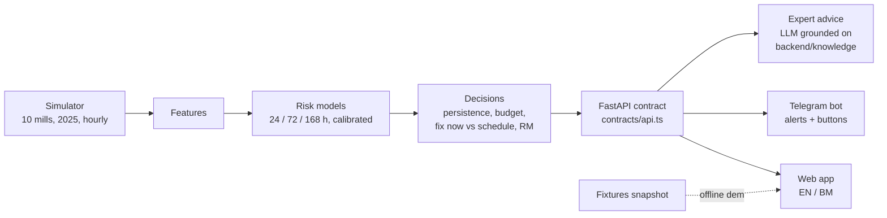

# MillGuard

**MillGuard tells a palm-oil mill's night-shift supervisor which machine to fix, why, and what it saves in ringgit.** It reads hourly sensor data from the screw presses and the boiler, scores the risk of each failure, and turns it into a short brief: *Act now*, *Watch* or *Normal*, with the fault fingerprint, a fix plan and the cost of waiting against the cost of fixing. On our simulated demo mill (mill 10, unseen in training, 2025) it cuts cost from RM3,153,791 (fix when it breaks) to RM1,782,706 and breakdowns from 108 to 19, and it beats a fixed service schedule built from published RCM intervals (RM2,735,945) by RM953,239. The same brief goes to a phone through Telegram, and a grounded AI advisor writes step-by-step guidance in English or Bahasa Malaysia.

**Live demo (no install, sample data):** https://finn1282.github.io/MillGuard/

## How it fits together



## How to run

```sh
make setup       # Python 3.11 env + dependencies (macOS: make libomp if LightGBM cannot find libomp)
make all         # simulate, train, tune on training mills, back-test mill 10, write artifacts (about 2 min)
make demo-all    # API + Telegram bot + web app at http://localhost:5173
make demo-offline  # last resort: web app built from fixtures at http://localhost:4173, no backend, no network
```
Run them in this order: `setup` → `all` → `check` → `demo-all`. `make check` runs the fixture checks, the backend tests and a frontend production build. Telegram and AI advice are optional: put keys in `backend/.env` (see `backend/.env.example`).

## What is real, simulated and assumed

| | What | Where it shows |
| --- | --- | --- |
| **Real** | MPOB 2025 oil extraction rate (19.74%), average CPO price (RM4,292.50/t) and monthly crop index | Every ringgit figure, the crop season in the simulator |
| **Real** | MetroPT-3 compressor data (real failures): used only as a stress test, result negative (0 of 4 caught early) | How it works, robustness |
| **Real** | A public boiler dataset, fetched at run time: no skill found (AUC 0.54), reported as a negative result | Robustness |
| **Real** | Component life distributions (worm, bearing, gearbox/shaft): lognormal fits to one palm oil mill's 2023 screw press failure records (Ishak et al., SENTI UGM 2024), cross-checked with three other studies; the simulator gives about 64 press breakdowns per mill in 7 months against 65 logged at a real North Sumatra mill (Aprilia et al., USU 2025) | `backend/params.yaml`, simulator |
| **Real** | The fixed-schedule baseline uses the RCM-recommended intervals of the same study (worm 525 h, bearing 533 h, gearbox/shaft 400 h), as published and untuned; cone and electrical have no published interval and run to failure | Impact page, `backend/params.yaml` |
| **Simulated** | All sensor readings, failures and work orders of the 10 mills (about 100 press stops per mill-year); mill 10 is never used for training or tuning | Everything on the Mill and Machine pages |
| **Assumed** | Warning periods before failure (worm 300 h, gearbox 400 h, bearing 150 h, cone 200 h), repair and breakdown costs, cone hydraulics life (no published figure), share of stopped production truly lost, 50% inspection accuracy, 1.5x parts cost for unplanned repair | `GET /api/assumptions` (marked validated or assumed), `backend/params.yaml` |

Every number lives in `backend/params.yaml` with its source and status.

## Data licences and AI

- MetroPT-3: CC BY 4.0 (UCI Machine Learning Repository), downloaded at run time.
- Boiler data: fetched at run time by `make fetch-boiler`, never committed or redistributed.
- MPOB statistics: public (Overview of the Malaysian Oil Palm Industry 2025).
- Expert advice uses Gemini through Grafilab's OpenAI-compatible endpoint, grounded only on the machine's own diagnosis, fingerprint, fix plan and history plus our own-words notes in `backend/knowledge/` (with source links). It is labelled AI-generated, never invents part numbers or torque values, and always includes lock-out/tag-out. The two demo moments are answered from stored fixtures, so no network is needed.
- The team built MillGuard with AI coding agents (Claude Code) and Claude Design.

## Known limitations

- The data is simulated. The warning periods are assumptions, so the savings are a model result, not a measured one.
- Back-test approximation: after an early repair the part is treated as renewed; its slightly earlier next wear-out is not modelled (median warning about 70 h against part lives of 600 to 1,000 h on average).
- Noise sensitivity: with sensor noise doubled, catches fall from 76 to 31 of 108 and false alarms rise to 2.8 a week; MillGuard plus a schedule (RM2,321,071) still costs less than the fixed schedule (RM2,735,945) but loses much of its edge. We show this on purpose. Training on noisy copies of the training mills was tried and not adopted (out-of-fold cost on the training mills rose 4.3%, over the 3% rule).
- Real-data tests were negative: MetroPT-3 0 of 4 caught early, real boiler data AUC 0.54.
- The alert limit (max 5 per shift) never bound on this mill: 89 of 90 alert shifts had a single alert, so it is shown as a fixed line, not a slider.

---

## Developer notes

`MASTER_PLAN.md` is the single source of truth. Backend: `backend/` and `contracts/`. Frontend: `frontend/`.

## Run it (Python 3.11, macOS or Linux)

```sh
make setup      # uv venv + dependencies (on macOS it also fixes the LightGBM libomp error by itself)
make libomp     # macOS only, if LightGBM fails with "libomp.dylib not found" (or: brew install libomp)
make all        # simulate -> train -> tune on training mills -> mill-10 backtest -> artifacts -> MetroPT-3 (about 2 min)
make api        # http://localhost:8000/docs  (CORS open)
```

`make all` prints failures caught, median lead time, false alarms per week and total RM for each policy.
The MetroPT-3 step downloads about 220 MB from UCI the first time (`make fetch-metropt`); if it fails the rest still completes.

Other targets:

| Target | What it does |
| --- | --- |
| `make roi` | Low / base / high ROI table from the same backtest the app uses |
| `make report` | Prints the 3 demo bookmarks with each card's numbers and the 4-policy table (default and strict inspection) |
| `make fixtures` | Re-snapshots `contracts/fixtures/` from the real API (run after `make all`) |
| `make demo-offline` | Last-resort demo: builds the frontend in fixture mode and serves it at http://localhost:4173 with no backend, bot or network |
| `make demo-all` | API + Telegram bot + frontend dev server (live API) |
| `make check` | Fixture checks, backend tests and a frontend production build; prints PASS/FAIL per stage |
| `MILLGUARD_STUB=1 make api` | Serves the fixtures instead of live artifacts (demo backup) |

## Telegram alerts (optional)

1. In Telegram, message @BotFather, send `/newbot`, and copy the token.
2. `cp backend/.env.example backend/.env` and paste the token after `TELEGRAM_BOT_TOKEN=` (the file is gitignored; never commit or share it).
   Optional: `TELEGRAM_ALLOWED_CHATS=` with comma-separated chat ids.
3. `make bot` (long polling, no public URL). Each person (or a group) sends `/start`; `/en` and `/bm` switch language, `/brief` sends the brief.
4. With `make api` running, the frontend (or `curl -X POST localhost:8000/api/notify -H 'content-type: application/json' -d '{"at":"2025-09-29T15:00:00+08:00","kind":"alert"}'`) sends what the replay clock shows. `GET /api/notify/status` says whether it is enabled.
5. Tapping Fix now / Schedule / Keep watching records feedback through the same code as `POST /api/feedback`.
Without a token everything still runs; `enabled` is false and nothing is sent.

## Expert advice (optional)

`POST /api/advice {asset_id, at, lang}` returns step-by-step guidance written by an LLM from the machine's own diagnosis, fingerprint, fix plan and history plus our notes in `backend/knowledge/`.
Put `LLM_API_KEY` (and optionally `LLM_BASE_URL`, default `https://llm.grafilab.ai/v1`, and `LLM_MODEL`, default `gemini/gemini-3-flash`) in `backend/.env`; any OpenAI-compatible provider works by changing these only (`backend/advice/llm.py`).
Answers are cached by (asset, time, language); `make fixtures` writes `advice_*` fixtures for Press 2 (act now) and Boiler 1 (whole mill) in EN and BM, kept unless `REFRESH_ADVICE=1`, and the demo bookmarks are answered from them without the network.
With no key or network the response is `cached: false`, empty sections and a friendly `message`; nothing crashes.

## Demo checklist (`make demo`)

`make demo` starts the API (port 8000) and the Telegram bot together; Ctrl+C stops both.
1. `make all` has been run once on this machine (artifacts exist) and `make fixtures` output is committed.
2. `backend/.env` has the bot token; the demo group has sent `/start` (`GET /api/notify/status` shows `enabled: true`, `subscribers: 1+`).
3. Open the frontend; check the time bar bookmarks: Quiet night, Whole mill, Press 2 act now.
4. At Press 2 act now press "Send to phone"; tap Schedule on the phone.
5. Backup: `MILLGUARD_STUB=1 make demo`, and if the API itself is not usable `make demo-offline` (frontend only, real-snapshot fixtures, advice included) serves the real-snapshot fixtures if live artifacts are missing.
6. Slide assets: `make pitch` rewrites `pitch/` (charts, tables, `numbers.md`).

## How it is built

- `backend/sim/` simulator: 10 mills, calendar 2025, hourly; 4 presses + 1 boiler; hidden component lives; assumed P-F warning periods (`params.yaml`).
- `backend/features/`, `backend/models/` rolling features, LightGBM risk at 24/72/168 h (calibrated), Isolation Forest, fault classifier.
- `backend/engine/` decision layer (persistence, hysteresis, shift budget, fix-now vs schedule), cost engine, backtest of 4 policies, SHAP reasons (EN/BM templates), diagnosis and fault fingerprint, fix-plan playbook (`text.py`).
- `backend/api/` FastAPI + Pydantic contract; `contracts/api.ts` mirrors the models.
- `backend/robustness/` MetroPT-3 check. `backend/params.yaml` holds every number with its source and status (validated / assumed).

## Rules we keep

- Train on mills 1-9 before 2025-09-01; test on mill 10 and months 9-12. No random splits. Nothing is tuned on the test mill.
- Never commit `backend/data/`, `.env` or the boiler dataset (CC BY-NC-ND).
- Contract changes: edit the models, regenerate fixtures, one line in `CHANGELOG.md`.

## Honest limits

- Simulated mills; the warning periods and several economics are assumptions (marked `assumed`).
- MetroPT-3 (real compressor data): 0 of 4 failures caught before they started.
