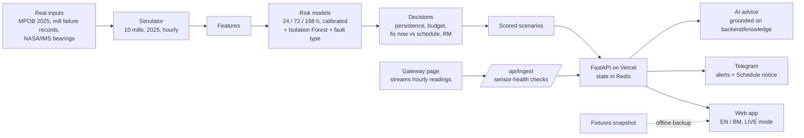

# MillGuard

**MillGuard tells a palm-oil mill's night-shift supervisor which machine to fix, why, and what it saves in ringgit.** It reads hourly sensor data from the screw presses and the boiler, scores the risk of each failure, and turns it into a short brief: *Act now*, *Watch* or *Normal*, with the likely fault, a fault fingerprint, 2–3 plain-language reasons and the cost of waiting against the cost of fixing. On our simulated demo mill (mill 10, unseen in training, 2025) it cuts cost from RM3,189,545 (fix when it breaks) to RM1,563,350 and breakdowns from 110 to 19, and it beats a fixed service schedule built from published RCM intervals (RM2,814,203) by RM1,250,853, catching 72 of 110 failures a median 70 hours ahead at 0.31 false alarms a week. The same brief goes to a phone through Telegram, and a grounded AI advisor writes step-by-step guidance in English or Bahasa Malaysia.

**Live app:** https://millguard-blush.vercel.app (Gateway page needs the presenter key to start a stream; anyone can watch).
**Offline backup (sample data only):** https://finn1282.github.io/MillGuard/

## How it fits together



## How to run

```sh
make setup       # Python 3.11 env + dependencies (macOS: make libomp if LightGBM cannot find libomp)
make all         # simulate, train (with noise/drift copies), tune on training mills, back-test mill 10, write artifacts (a few minutes)
make demo-all    # API + Telegram bot + web app at http://localhost:5173
make demo-offline  # last resort: web app built from fixtures at http://localhost:4173, no backend, no network
```
Run them in this order: `setup` → `all` → `scenarios` → `check` → `demo-all`. `make check` runs the fixture checks, the backend tests and a frontend production build. Telegram and AI advice are optional: put keys in `backend/.env` (see `backend/.env.example`).

## Gateway and live mode

MillGuard has a gateway API that any data source can post hourly sensor summaries to. There is no hardware in this project, so every source below is **simulated**.

- **Where the data comes from.** Each scenario (`mill10`, `bearing_p3`, `worm_p1`, `boiler_water`, `bad_sensor`, or your own CSV) is generated by our simulator and scored by the trained models when it is built (`make scenarios`, about 55 s): the same features, models, decision rules and thresholds as mill 10. No risk value is written by hand.
- **What the stream does.** The client (the browser Gateway page, or `make stream SCENARIO=bad_sensor`) fetches the scenario hour by hour and POSTs each hour to `/api/ingest`, as a real gateway would. While a session is active, the Mill and Machine pages show that scenario's scoring at the hour reached.
- **What the gateway itself does.** `/api/ingest` checks every reading (out of physical range, frozen for 6+ hours, a spike beyond 6 robust standard deviations of the last 72 hours, missing for 3+ hours), keeps the last 72 hours per asset, and tracks which hour all five assets have reported (`live_at`). A bad reading raises a **sensor alert** ("check the sensor, not the machine"); it never raises a machine alert, and flagged readings are masked before the models score them; while a sensor is quarantined (and for a day after) the machine's risk is held at its last trusted value, so a broken sensor cannot raise a machine alert.
- **Honest limit.** Readings from a real external gateway would be checked and stored, but not scored by the models yet: scoring happens when a scenario is built. Do not read the demo as live inference on live plant data.

```sh
make scenarios                       # build the five scenarios (about 55 s)
make live                            # API + Telegram polling bot, shared state, auto-notify of new alerts
make stream SCENARIO=bad_sensor SPEED=2   # in another terminal: 2 s of wall clock per simulated hour
```

One message per asset per hour:

```json
{"gateway_id": "demo-gw1", "source": "scenario:bearing_p3", "asset_id": "press_2", "t": "2025-09-26T14:00:00+08:00",
 "readings": {"motor_current": 61.2, "throughput_tph": 15.1, "vib_rms": 2.04, "vib_kurtosis": 3.1,
              "gearbox_oil_temp": 68.4, "cone_pressure": 46.2, "fibre_oil_loss": null}}
```

| Field | Real sensor that would feed it |
| --- | --- |
| `motor_current` (A) | Current transformer (CT clamp) on the press motor |
| `vib_rms` (mm/s), `vib_kurtosis` | Accelerometer on the gearbox or bearing housing; RMS and kurtosis computed at the edge (ESP32 or Raspberry Pi) |
| `gearbox_oil_temp` (°C) | PT100 in the gearbox oil |
| `cone_pressure` (bar) | Pressure transducer on the cone hydraulics |
| `throughput_tph` | Weighbridge or feed conveyor load from the PLC |
| `fibre_oil_loss` (%) | Daily laboratory sample (null in other hours) |
| `steam_temp`, `steam_pressure`, `feedwater_flow`, `feedwater_cond` | Boiler PLC tags |

Endpoints (contract v1.14): `POST /api/ingest`, `GET /api/live`, `POST /api/live/start`, `POST /api/live/stop`, `GET /api/scenarios`, `GET /api/scenarios/{id}/hours`, `POST /api/upload` (CSV, local only), `POST /api/telegram/webhook`. Write endpoints (`ingest`, `live/start`, `live/stop`, `upload`, `notify`, `feedback`) need the header `X-Demo-Key` when `DEMO_KEY` is set. All state goes through `backend/state.py`: memory by default, a shared file for `make live`, Upstash Redis when `KV_REST_API_URL` and `KV_REST_API_TOKEN` are set. For a webhook instead of polling: set `TELEGRAM_WEBHOOK_SECRET`, then `python -m backend.scripts.set_webhook https://<host>/api/telegram/webhook` (or `--delete`).

## What is real, simulated and assumed

| | What | Where it shows |
| --- | --- | --- |
| **Real** | MPOB 2025 oil extraction rate (19.74%), average CPO price (RM4,292.50/t) and monthly crop index | Every ringgit figure, the crop season in the simulator |
| **Real** | MetroPT-3 compressor data (real failures): used only as a stress test, result negative (0 of 4 caught early) | `GET /api/robustness`, this README |
| **Real** | A public boiler dataset, fetched at run time: no skill found (AUC 0.54), reported as a negative result | `GET /api/robustness`, this README |
| **Real** | Component life distributions (worm, bearing, gearbox/shaft): lognormal fits to one palm oil mill's 2023 screw press failure records (Ishak et al., SENTI UGM 2024), cross-checked with three other studies; the simulator gives about 64 press breakdowns per mill in 7 months against 65 logged at a real North Sumatra mill (Aprilia et al., USU 2025) | `backend/params.yaml`, simulator |
| **Real** | The fixed-schedule baseline uses the RCM-recommended intervals of the same study (worm 525 h, bearing 533 h, gearbox/shaft 400 h), as published and untuned; cone and electrical have no published interval and run to failure | Impact page, `backend/params.yaml` |
| **Real** | Bearing warning period (98.5 h, the median of 275, 121, 76 and 60 h) and the shape of the bearing vibration ramp: measured on the four bearings that failed in the NASA/IMS run-to-failure tests (Qiu, Lee, Lin, Yu 2006); only the size of the ramp in our vibration units is assumed | `backend/artifacts/ims_bearings.json`, `backend/params.yaml` |
| **Simulated** | All sensor readings, failures and work orders of the 10 mills (about 100 press stops per mill-year), plus noisy (x2) and drifting copies of training mills 1–9 used for training; mill 10 is never used for training or tuning | Everything on the Mill, Machine and Gateway pages |
| **Assumed** | Warning periods before failure (worm 300 h, gearbox 400 h, cone 200 h), repair and breakdown costs, cone hydraulics life (no published figure), share of stopped production truly lost, 50% inspection accuracy, 1.5x parts cost for unplanned repair | `GET /api/assumptions` (marked validated or assumed), `backend/params.yaml` |

Every number lives in `backend/params.yaml` with its source and status.

## Data licences and AI

- MetroPT-3: CC BY 4.0 (UCI Machine Learning Repository), downloaded at run time.
- Boiler data: fetched at run time by `make fetch-boiler`, never committed or redistributed.
- MPOB statistics: public (Overview of the Malaysian Oil Palm Industry 2025).
- NASA/IMS bearing data (Center for Intelligent Maintenance Systems, University of Cincinnati; NASA PCoE repository): US government work, downloaded at run time to `backend/data/ims/` (gitignored); only our derived summary `backend/artifacts/ims_bearings.json` is committed.
- Published studies used for calibration are cited in `backend/params.yaml` (Ishak et al. 2024; Yudistia et al. 2026; Ramadhana 2026; Wahyuny 2021; Aprilia et al. 2025).
- Expert advice uses Gemini through Grafilab's OpenAI-compatible endpoint, grounded only on the machine's own diagnosis, fingerprint, fix plan and history plus our own-words notes in `backend/knowledge/` (with source links). It is labelled AI-generated, never invents part numbers or torque values, and always includes lock-out/tag-out. The two demo moments are answered from stored fixtures, so no network is needed.
- The team built MillGuard with AI coding agents (Claude Code) and Claude Design.

## Known limitations

- The data is simulated. The bearing warning period is measured on real bearings, but the other warning periods and the repair costs are assumptions, so the savings are a model result, not a measured one.
- Back-test approximation: after an early repair the part is treated as renewed; its slightly earlier next wear-out is not modelled (median warning about 70 h against part lives of 600 to 1,000 h on average).
- Noise sensitivity: the models are trained on the training mills plus noisy (x2) and drifting copies of them. With sensor noise doubled, schedule + MillGuard (RM1,614,806) still beats the fixed schedule (RM2,814,203); with noise tripled it does not: it catches 48 of 110, raises 5.8 false alarms a week and costs RM3,164,774, more than the fixed schedule. We show this on purpose.
- Real-data tests were negative: MetroPT-3 0 of 4 caught early, real boiler data AUC 0.54.
- The alert limit (max 5 per shift) is shown as a fixed line on the Impact page, not a slider.
- Fault types with little warning are caught less often: electrical 1 of 6, gearbox/shaft 13 of 31 (bearings 34 of 40). The schedule underneath covers them.

---

## Developer notes

`MASTER_PLAN.md` is the single source of truth. Backend: `backend/` and `contracts/`. Frontend: `frontend/`.

## Run it (Python 3.11, macOS or Linux)

```sh
make setup      # uv venv + dependencies (on macOS it also fixes the LightGBM libomp error by itself)
make libomp     # macOS only, if LightGBM fails with "libomp.dylib not found" (or: brew install libomp)
make all        # simulate -> train (with noise/drift copies; --no-augment skips them) -> tune on training mills -> mill-10 backtest -> artifacts -> MetroPT-3 (a few minutes)
make api        # http://localhost:8000/docs  (CORS open)
```

`make all` prints failures caught, median lead time, false alarms per week and total RM for each policy.
The MetroPT-3 step downloads about 220 MB from UCI the first time (`make fetch-metropt`); if it fails the rest still completes.

Other targets:

| Target | What it does |
| --- | --- |
| `make roi` | Low / base / high ROI table from the same backtest the app uses |
| `make report` | Prints the 3 demo bookmarks with each card's numbers and the 4-policy table (default and strict inspection) |
| `make fixtures` | Re-snapshots `contracts/fixtures/` from the real API (run after `make all`) |
| `make demo-offline` | Last-resort demo: builds the frontend in fixture mode and serves it at http://localhost:4173 with no backend, bot or network |
| `make demo-all` | API + Telegram bot + frontend dev server (live API) |
| `make check` | Fixture checks, backend tests and a frontend production build; prints PASS/FAIL per stage |
| `MILLGUARD_STUB=1 make api` | Serves the fixtures instead of live artifacts (demo backup) |

## Deployment (Vercel)

One Vercel project serves the web app (`frontend/dist`) and the API (`api/index.py`, the FastAPI app as one Python function; `/api/*` is rewritten to it, so the app calls the same origin and needs no `VITE_API_URL`).

1. `vercel login` and `vercel link` once. In the project settings add: `KV_REST_API_URL` and `KV_REST_API_TOKEN` (Upstash Redis, from the Vercel Marketplace; without it state is per-instance memory and the live session will not hold), `DEMO_KEY` (protects the write endpoints; the browser sends it as `X-Demo-Key`), `TELEGRAM_BOT_TOKEN`, `TELEGRAM_WEBHOOK_SECRET`, `TELEGRAM_SUBSCRIBERS` (`chatid:lang,...`, so the group is subscribed without a `/start`), `LIVE_AUTONOTIFY=1`, `VERCEL_SUPPORT_LARGE_FUNCTIONS=1` (also set in `vercel.json`; allows a function above 250 MB, the Large Functions beta on Fluid compute), and optionally `LLM_API_KEY`.
2. `make vercel-deploy`: builds the artifacts and scenarios if missing (`make all scenarios`), then `vercel deploy --prod`. `.vercelignore` replaces `.gitignore` for the upload, so the built `backend/artifacts/` (including `scenarios/`) reaches the function; models, `backend/data/` and `.env` do not.
3. `make set-webhook URL=https://<project>.vercel.app` points Telegram at `/api/telegram/webhook`. Stop `make bot` first: polling and a webhook cannot both be active. `make set-webhook URL=delete` goes back to polling.

Notes: the function installs the slim root `requirements.txt` (no lightgbm, scikit-learn or shap: they are only needed to build artifacts, and `api/index.py` stubs the `shap` import); feedback goes through `backend/state.py` (Redis on Vercel); CSV upload builds a scored scenario on local disk, so it is local only (501 on Vercel). The function bundle is close to or above 250 MB uncompressed, so it relies on Large Functions (see above).

## Telegram alerts (optional)

1. In Telegram, message @BotFather, send `/newbot`, and copy the token.
2. `cp backend/.env.example backend/.env` and paste the token after `TELEGRAM_BOT_TOKEN=` (the file is gitignored; never commit or share it).
   Optional: `TELEGRAM_ALLOWED_CHATS=` with comma-separated chat ids.
3. Locally: `make bot` (long polling, no public URL). On Vercel the same commands arrive through the webhook (`make set-webhook`); never run both. Each person (or a group) sends `/start`, or list chats in `TELEGRAM_SUBSCRIBERS`; `/en` and `/bm` switch language, `/brief` sends the brief.
4. With `make api` running, the frontend (or `curl -X POST localhost:8000/api/notify -H 'content-type: application/json' -d '{"at":"2025-09-29T15:00:00+08:00","kind":"alert"}'`) sends what the replay clock shows. `GET /api/notify/status` says whether it is enabled.
5. Tapping Fix now / Schedule / Keep watching records feedback through the same code as `POST /api/feedback`.
Without a token everything still runs; `enabled` is false and nothing is sent.

## Expert advice (optional)

`POST /api/advice {asset_id, at, lang}` returns step-by-step guidance written by an LLM from the machine's own diagnosis, fingerprint, fix plan and history plus our notes in `backend/knowledge/`.
Put `LLM_API_KEY` (and optionally `LLM_BASE_URL`, default `https://llm.grafilab.ai/v1`, and `LLM_MODEL`, default `gemini/gemini-3-flash`) in `backend/.env`; any OpenAI-compatible provider works by changing these only (`backend/advice/llm.py`).
Answers are cached by (asset, time, language); `make fixtures` writes `advice_*` fixtures for Press 2 (act now) and Boiler 1 (whole mill) in EN and BM, kept unless `REFRESH_ADVICE=1`, and the demo bookmarks are answered from them without the network.
With no key or network the response is `cached: false`, empty sections and a friendly `message`; nothing crashes.

## Demo checklist

Live (Vercel):
1. Open https://millguard-blush.vercel.app 10 minutes early to wake the function; no "Offline sample data" badge.
2. `/brief` in the Telegram group gets a reply (webhook works).
3. Gateway page → presenter key → "Held-out mill 10" at 1 s per hour → the Press 2 alert opens after about 72 s and reaches Telegram.
4. Open Press 2 → Schedule → "Engineers notified on Telegram" and the group gets the scheduled message.
5. "Faulty sensor on Press 4" → amber sensor check, no machine alarm.
6. Share → QR so judges can watch on their phones.

Backups, in order: reload once (cold start); laptop `make set-webhook URL=delete` then `LIVE_AUTONOTIFY=1 make demo-all` (http://localhost:5173); `make demo-offline`; the recorded video.
Slide assets: `make pitch` rewrites `pitch/` (charts, tables, `numbers.md`).

## How it is built

- `backend/sim/` simulator: 10 mills, calendar 2025, hourly; 4 presses + 1 boiler; component lives from published mill failure records; bearing warning period and vibration ramp from NASA/IMS; other P-F warning periods assumed (`params.yaml`).
- `backend/features/`, `backend/models/` rolling features relative to each machine's own 30-day baseline, LightGBM risk at 24/72/168 h (calibrated), Isolation Forest, fault classifier; trained on mills 1–9 plus noisy (x2) and drifting copies.
- `backend/engine/` decision layer (persistence, hysteresis, shift budget, fix-now vs schedule), cost engine, backtest of 4 policies, SHAP reasons (EN/BM templates), diagnosis and fault fingerprint, fix-plan playbook (`text.py`).
- `backend/api/` FastAPI + Pydantic contract; `contracts/api.ts` mirrors the models.
- `backend/gateway/` ingest, sensor-health checks, live sessions, scenarios, CSV upload; `backend/state.py` all mutable state (memory, file or Redis); `api/index.py` Vercel entry.
- `backend/robustness/` stress tests, MetroPT-3 and boiler checks; `backend/scripts/ims_bearings.py` the NASA/IMS measurement. `backend/params.yaml` holds every number with its source and status (validated / assumed).

## Rules we keep

- Train on mills 1-9 before 2025-09-01; test on mill 10 and months 9-12. No random splits. Nothing is tuned on the test mill.
- Never commit `backend/data/`, `.env` or the boiler dataset (CC BY-NC-ND).
- Contract changes: edit the models, regenerate fixtures, one line in `CHANGELOG.md`.

## Honest limits

- Simulated mills; several warning periods and economics are assumptions (marked `assumed`).
- Real-data checks on other machines were negative (MetroPT-3 0 of 4; boiler AUC 0.54); tripled sensor noise makes MillGuard worse than a plain schedule.
- In the live demo, readings stream through the real ingest API, but they were scored by the models when the scenario was built, not on arrival.
